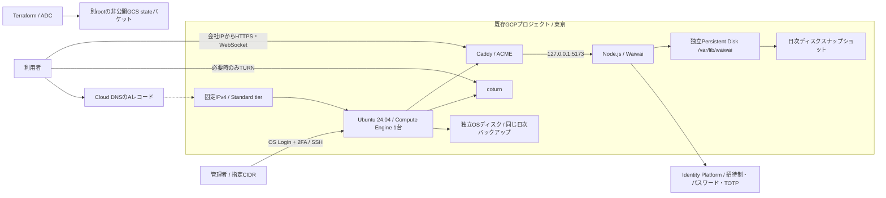

# Waiwai GCP dev 基本設計

## 対象

最大150同時接続、平日15時間程度の利用、音声30人が5人以内の小グループで会話する想定です。人数はチーム別サーバーの合計で評価します。30人の一斉音声会議・無停止・マルチゾーン冗長化は対象外です。2026-10-20にドメイン取得と全3 rootの基盤applyを完了しました。VM初期化・DNS・HTTPS・Identity Platform設定は確認済みで、アプリ配備と実GCP上の性能確認は未実施です。

既存の課金が有効なGCPプロジェクトを入力で指定します。プロジェクトや課金アカウントはTerraformで作成・付け替えしません。既存VPCやデフォルトのComputeサービスアカウントも変更しません。

## 構成

ロードバランサー、GKE、Cloud Run、Cloud SQL、Cloud NAT、Artifact Registryは追加しません。常時WebSocketとUDP音声中継を既存の構造で動かせる単一VMを採用します。VMに外部IPがあるため、別のNAT Gatewayは不要です。取得はCloud Domains、公開DNSはCloud DNSで管理し、ゾーンの初期設定をVMから分離します。Azureの`cloudapp.azure.com`をGCPへ流用しません。

## リソース

以下はTerraformで管理する基盤です。自動生成物・VM内のソフトウェア・外部サービスの設定・公開前の未実装事項まで含む[全体一覧](resource-inventory.md)を別に管理します。Terraformの31エントリーだけで公開・監視・認証設定まで完成するものではありません。

| モジュール | リソース・設定 |
|---|---|
| dev root | Compute Engine / OS Login / Identity Toolkit / Secure Token / IAM APIの有効化。destroyで既存プロジェクトのAPIを無効化しない |
| dev root / 認証 | Identity Platformの招待制・TOTP設定、ユーザー読取専用サービスアカウントとカスタムロール |
| DNS bootstrap | Cloud Domains / Cloud DNS API、DNSSEC付き公開ゾーン。独立したlocal state |
| dev root / DNS | 初期化済みzoneのdomainを読み取り検証し、固定IPのAレコードを管理 |
| network | 専用custom VPC、IPv4 `/24` Subnet、固定外部IPv4、SSH/Web/TURNの4種類のFirewall |
| office-vm | VM一台、OS 20GB・data 32GBの`pd-balanced`、インスタンス単位のOS Admin Login IAM |
| office-vm | 日次Snapshot Resource Policy、OS/dataディスクへの個別attachment |
| terraform-state | 東京のGCSバケット、均一IAM、公開禁止、版管理、30日soft delete、指定運用者のobjectAdmin |

regionは`asia-northeast1`、zoneは初期`asia-northeast1-a`。現段階は東京以外を入力で選べない構成です。VPCはdefaultを使わず、既定Subnetは`10.84.1.0/24`、VMはhost 10の`10.84.1.10`。会社ネットワークとの重複は構築前に確認します。

## 容量と費用

初期は`e2-custom-2-4096`（2 vCPU / 4GiB）。E2のshared-core機種を使わず、負荷不足時の候補は`e2-custom-4-8192`（4 vCPU / 8GiB）です。`machine_type`で選べ、変更時にはVM停止が発生します。自動増強・VMの横増設はしません。アプリのJSON・SQLite・オンライン状態が単一サーバー前提のためです。[E2の公式仕様](https://docs.cloud.google.com/compute/docs/general-purpose-machines#e2_machine_types)を参照してください。

systemdの上限はアプリ1536MiB、TURN768MiB、ファイル数65536です。これは容量保証や予約量ではありません。増強後も制限を保持し、アプリ側のメモリが原因なら実測に基づいて別途変更します。TURNは既存設計の600割当・利用者32割当・ユーザー128000byte/s・全体16000000byte/sを維持する想定です。利用者端末の接続相手は最大4人です。

費用はVM稼働時間、2枚のディスク、Snapshot保存、外部IPv4、インターネット送信量、GCS state保存、ドメイン登録・更新、Cloud DNSのzone/問い合わせ料で見積もります。TURN経由の実音声とWebSocket配信量が変動要因です。停止中もディスク・Snapshot・固定IP等の費用は残ります。自動停止は運用時間・会議の例外が未確定のため実装しません。金額は構築時点の[料金計算](https://cloud.google.com/products/calculator)で再確認し、AzureのコミットをGCPへ適用できる前提にはしません。

## 通信と本人確認

| ポート | 用途・接続元 |
|---|---|
| TCP 22 | 運用者の指定IPv4 `/24`〜`/32`だけ。OS Login + 2FAを必須化 |
| TCP 80 / 443 | CaddyのACME・HTTPS。Firewallは到達可能にし、全WebルートをCaddyで会社IP制限 |
| TCP 3478 / 5349 | 認証付きTURN / TURN TLS |
| UDP 3478 / 49160–49959 | TURNリスナー・メディアリレー |
| 127.0.0.1:5173 | VM内のCaddy→アプリだけ。Firewallへ公開しない |

Webの許可元はdigdaのdev `allowed_source_cidrs`を参照する21件で、入力はIPv4 `/20`〜`/32`を受け付けます。SSHの運用者用CIDRとは独立して管理し、Web用プロキシの範囲をSSHへ自動転用しません。実値・参照時点はローカルの入力記録へ保存します。

Firewallは専用network tagのVMだけに適用します。VPC内の相互許可ルールは追加せず、未許可の受信はGCPの暗黙denyに任せます。送信は更新・ACME・認証・外部音声peerのため既定allowを使用します。Webの制限は直接の接続元IPを見ており、利用者からの`X-Forwarded-For`は信用しません。前段にプロキシを入れる場合は再設計が必要です。

SSHは`enable-oslogin=TRUE`・`enable-oslogin-2fa=TRUE`、プロジェクトSSH鍵の遮断、パスワード/rootログイン禁止です。OS Loginの2FAが使える人間のユーザー・グループだけに、当該VMの`roles/compute.osAdminLogin`を付与します。既存プロジェクト全体のOwner/Editorを追加しません。CLIで接続する運用者には別途`compute.projects.get`の権限、組織外ユーザーには組織側のOS Login許可が必要な場合があります。[OS Loginの公式条件](https://docs.cloud.google.com/compute/docs/oslogin/set-up-oslogin)を確認してください。

Secure Boot・vTPM・integrity monitoringを有効化し、アプリVMにはIdentity Platformのユーザー状態を確認する専用サービスアカウントを付与し、`firebaseauth.users.get`だけを許可します。秘密鍵を作らずADCを使用します。Waiwaiとcoturnはそれぞれ非rootユーザーで実行します。Google CLIログイン、OS Login、Waiwaiの利用者ログインは別です。GCPに置いてもMicrosoft/Slackの既存ログインを利用でき、GoogleアカウントでのWaiwaiログイン機能を自動追加するものではありません。

本番公開時には認証必須のアプリ設定とMFA、会社外参加者の招待方法を確認します。旧環境でEntraを利用する場合は既存の署名検証・不変ID・招待/割当/MFAを維持します。未認証ゲストやBasic認証だけの公開へ切り替えません。初期化だけではアプリ設定ファイルも本体もなく、Waiwaiサービスは開始しません。

GCP公開時はIdentity Platformの招待制メール・パスワードとTOTP MFAを採用します。クライアントの自己登録は禁止し、招待・メール確認・TOTP認証と現在のユーザー状態をサーバーで検証してから入室セッションを発行します。利用者全員のGoogle/Microsoftアカウントは不要です。既存Slack/Entraとの紐付けは管理者が固定IDで明示し、メール一致による自動統合は行いません。設定・招待・失効・実機確認は[Identity Platform設計](identity-platform.md)を参照してください。

Slack EventsのIP制限例外は既定OFFで、明示的なON時もPOST `/api/slack/events`だけです。署名・時刻・workspace・channel検証はアプリ側に残します。TURNの共有鍵とログイン用SecretはTerraform・metadata・stateへ渡さず、後続の配備で権限を制限したファイルに保存します。TURN TLSの証明書はCaddyから同期します。443しか許可されない会社回線にTURNを通す構成は別途必要です。

## 初期化・永続化・復旧

`user-data`のcloud-initでCaddy、coturn、チェックサムを固定したNode.js、systemd、TURNの証明書同期を設定します。ディスクは`/dev/disk/by-id/google-waiwai-data`を使用し、署名がない場合だけext4初期化します。既存FSをフォーマットせずUUIDでマウントし、マウントがない状態でアプリを起動させません。

`/var/lib/waiwai`には既存のJSON・チャット/個人データSQLiteと、追加サーバーの`spaces/<ID>/`をまとめて保存します。VMと2枚のディスクを削除防止にし、boot diskのauto-deleteも無効にします。VMテンプレートの変更は`terraform_data.bootstrap_revision`で置換として検知し、prevent_destroyで暗黙の再作成を止めます。cloud-initを変更しても既存VMへ自動再適用されないためです。会社IPやCaddy設定の変更も保守計画として扱います。

日次SnapshotはUTC17時（JST翌2時台）の開始枠、保持は7日です。元ディスク削除後の自動Snapshotは保持する設定なので、削除後は運用者が保管方針を確認します。OSとdataは独立したSnapshotで、同時点のアプリ整合性や無損失は保証しません。`guest_flush=false`で、SQLiteのWALを含めたクラッシュ整合性の復元・integrity_checkが必要です。[Snapshotの仕様](https://docs.cloud.google.com/compute/docs/disks/about-snapshot-schedules)を参照してください。

stateは別rootのGCSへ保存し、Azure Blobと共有しません。GCS backendのロックと版管理で誤更新から復旧できるようにし、bootstrapのローカルstateも安全に保管します。バケットはforce_destroyを無効化し、prevent_destroyと公開アクセス禁止を設定します。版履歴は自動削除しないため、長期運用では容量も確認します。[GCS backend](https://developer.hashicorp.com/terraform/language/backend/gcs)を参照してください。

単一VM停止中はオフィスも止まります。Google上でのSKU/クォータ/組織Policy確認、強制TURNの実音声、負荷試験、バックアップ復元は公開前の受入です。監視・ログ収集・通知・予算ルールは現IaCに未実装です。運用メールを指定しても、`acme_email`が設定するのは証明書の連絡先であり、監視メール通知は作成されません。方式・閾値・予算額を決めて別途整備します。

ドメイン購入は登録者情報をstateへ残さないCLI管理とし、Terraformの33件とは別に登録リソース1件を扱います。[取得とDNSの手順](domain-registration.md)を参照してください。ドメイン取得・登録者メール確認・DNSゾーン・VM作成は完了しています。アプリ本体の配備と実ユーザーの受入は残っています。
