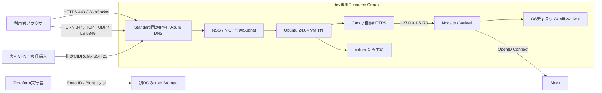

# Waiwai Azure dev 基本設計

## 対象と前提

今回の完成範囲はdev向け設計書とTerraform実装です。Azureへのapply、アプリ配備、会社アカウントの設定変更は実施しません。stg/prdは作りません。

最大150同時接続、平日15時間程度の利用、音声30人が複数の小グループで会話する想定です。全員での一斉音声会議は対象外です。低コストの単一VM構成を維持し、会社のAzureコミット適用可否・実請求額は構築前に確認します。

## 構成

Kubernetes、ロードバランサー、NAT Gateway、コンテナレジストリ、DBは追加しません。P2Pが可能な相手は直接通信し、必要時にTURNへフォールバックします。

## リソース一覧と責務

| 所属 | リソース | 設定 |
|---|---|---|
| dev root | Resource Group 1個 | アプリ資源の管理単位 |
| network | VNet 1個 / Subnet 1個 | 既定10.83.0.0/16、Subnetは10.83.1.0/24。会社ネットワークと重複時は変更 |
| network | NSG / 3つの明示的受信ルール | SSH・Web/TURN TCP・TURN UDP |
| network | NIC / 固定Public IP | Private IPはSubnetのhost 4、Public IPはStatic/Standard/Internet routing。既定Public IPゾーン1/2/3 |
| office-vm | Linux VM 1台 / OSディスク | Ubuntu 24.04 x64、32GiB StandardSSD LRS |
| terraform-state | 別Resource Group / Storage Account / Container / RBAC | アプリのdestroyから独立。LRS、Entra ID、共有キー無効、TLS1.2、Blob版管理、削除回復30日 |

Public IPのゾーン設定はVM冗長化ではありません。VMもアプリプロセスも1つです。会社のSKU・ゾーン制約は実Azureでのplan前に確認します。

## 容量設計と受入基準

初期VMは`Standard_B2als_v2`（2 vCPU / 4GiB）。既存のMac上負荷試験を参照しつつ、Azure上の性能保証とは扱いません。音声は1端末最大4接続、5人以内のグループを想定します。30人が1か所に集まる使い方にはSFU等の別設計が必要です。

アプリのsystemd上限はMemoryMax 1536MiB、coturnは768MiB、ファイル上限は65536。上限は使用量や性能保証ではなく暴走時の制御です。TURNは全体600割当、利用者32割当、ユーザー128000byte/s・全体16000000byte/sの帯域制限を既存設定から引き継ぎます。

実際のAzure利用開始後に、150接続・30人の音声シグナリング試験、会社回線を含む強制TURNのメディア試験を行います。連続1時間以上で応答遅延、切断、CPU、CPU Credits Remaining、メモリ、送信量を評価します。CPUクレジットが減り続ける場合は長時間試験も必要です。

不足した場合の増強候補は`Standard_B4als_v2`（4 vCPU / 8GiB）。`vm_size`だけで選択可能にしていますが、自動増強はしません。メモリ上の参加者状態・単一JSON永続化があるため、VM台数の増加はそのままでは対応できません。

## 通信と認証

| 方向・ポート | 用途・接続元 |
|---|---|
| 受信 TCP 22 | 指定IPv4 /24〜/32のみ（通常管理端末/VPNの/32） |
| 受信 TCP 80 / 443 | ACME・HTTPS・WebSocket。インターネット |
| 受信 TCP 3478 / 5349 | TURN/TURN TLS。インターネット |
| 受信 UDP 3478 / 49160〜49959 | TURNリスナー・リレー。インターネット |
| VM内部 127.0.0.1:5173 | Caddy → アプリ。NSGでインターネットへ許可しない |
| 送信 | Azure既定のNSG送信許可を使用。更新、DNS、ACME、Slack、TURN peer等。固定Public IPから明示的に送信 |

NSGは明示ルール以外にAzure既定ルール（VNet内、Load Balancer、DenyAllInbound等）を持ちます。Private SubnetでAzure既定の暗黙送信を無効化し、NICのPublic IPを使用します。

SSHは公開鍵のみ、root/パスワードログイン無効、Secure BootとvTPMを有効化します。Slackログインは必須、許可ワークスペースを限定し、未認証WebSocket接続も拒否します。起動設定とアプリは別のsystemdユーザーで実行します。

Slack Client Secret・TURN共有鍵・SSH秘密鍵はTerraform変数、cloud-init、stateへ渡しません。アプリ配備時に専用SSH鍵で転送し、VMの権限制限されたファイルへ保存します。TURN共有鍵から期限付きHMAC資格情報を生成し、ブラウザへ共有鍵は配布しません。TURNはloopback・RFC1918・link-local等への中継を拒否します。

会社回線が443のみ許可の場合、このTURN TLS 5349構成では足りません。その条件が確認されたら443対応の中継設計を別途行います。

## 初期化・配備

cloud-initはCaddy、coturn、チェックサム固定のNode.js、systemd unit、証明書同期タイマーを準備します。アプリ本体は後続のデプロイで配置し、初期化だけでは利用開始しません。生成テンプレートに秘密値は含めません。

`deploy.mjs`はdevのTerraform出力のみを受け付けます。TURN内部IPを出力から取得するため、VNet変更にも追従します。共有鍵を維持しながら世代別リリースを転送し、ヘルスチェック失敗時は直前のコード・設定へ戻します。Caddyの証明書をTURN TLSへ定期同期します。

## state・データと復旧

アプリstateは`waiwai.dev.tfstate`、bootstrapは独立したローカルstateです。bootstrapのstateも会社の安全な保管場所へバックアップします。state用RG・Storage・Containerは`prevent_destroy`で保護します。ただし構成ブロックの削除や権限者の手動操作までは防げないため、変更レビューも必要です。Blob Storageの公開ネットワークエンドポイントは有効で、匿名・共有キーは使わずEntra RBACで制限します。Private Endpointは今回追加しません。

家具・メンバー・共有リンク・館内放送のJSONは`/var/lib/waiwai`に置き、通常のアプリ再配備で維持します。VM/OSディスク削除では失われるので、全社運用開始前に会社のバックアップ手順を決め、復元を試験します。自動VMバックアップは今回の実装に含みません。セッション・オンライン状態はメモリ上で、再起動後は再ログインが必要です。

運用の入口は`/healthz`、Azure VMメトリクス、`journalctl`です。ログは最大256MiB・7日目安。自動アラート・予算通知の接続先と閾値は会社の運用情報受領後に設定します。単一VM停止・更新・再配備中の切断があり、無停止や災害復旧のSLAは設定しません。

## 今回の検証と残る確認

認証不要のformat・validate・Providerモックテスト・デプロイ設定の単体テストを実行します。Azureの課金資源作成、実アカウントでのplan、SKU/クォータ/Policy確認、会社回線のTURN試験、バックアップ復元試験は未実施です。会社サブスクリプション・管理CIDR・運用メール受領後に進めます。
